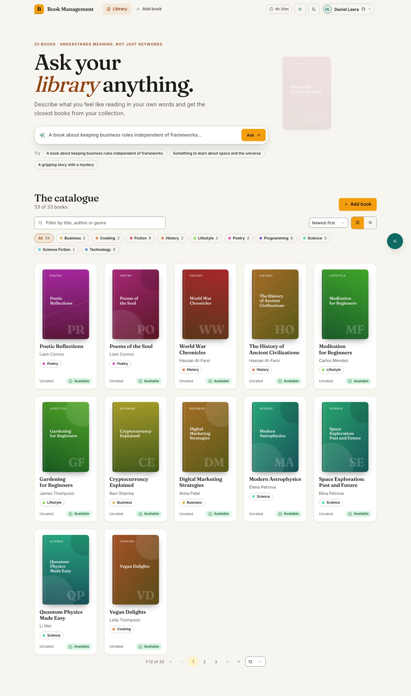
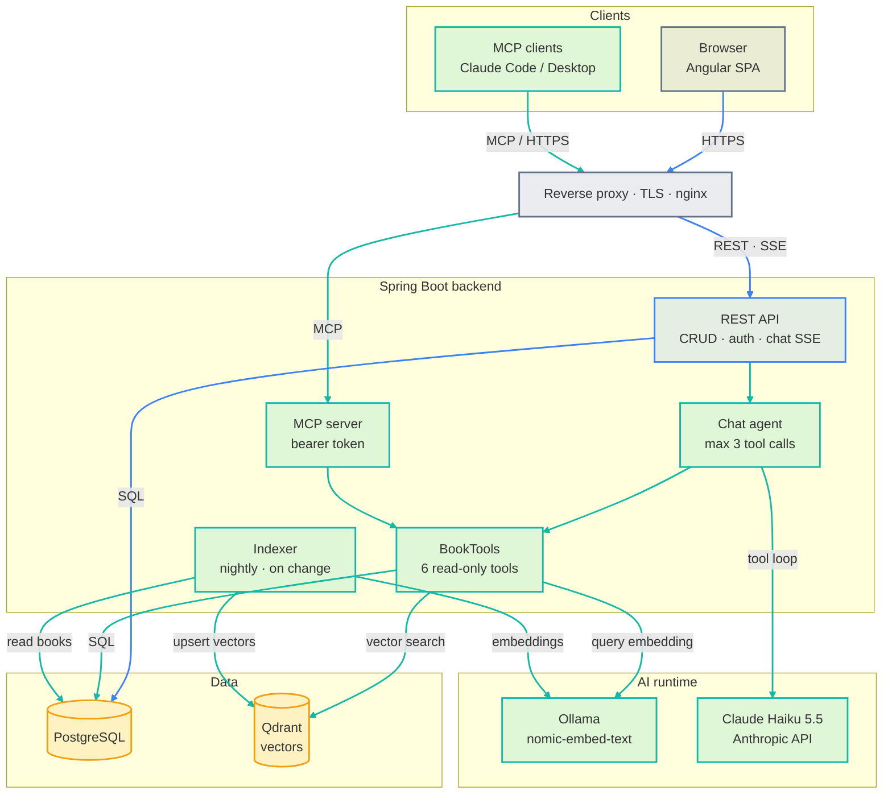
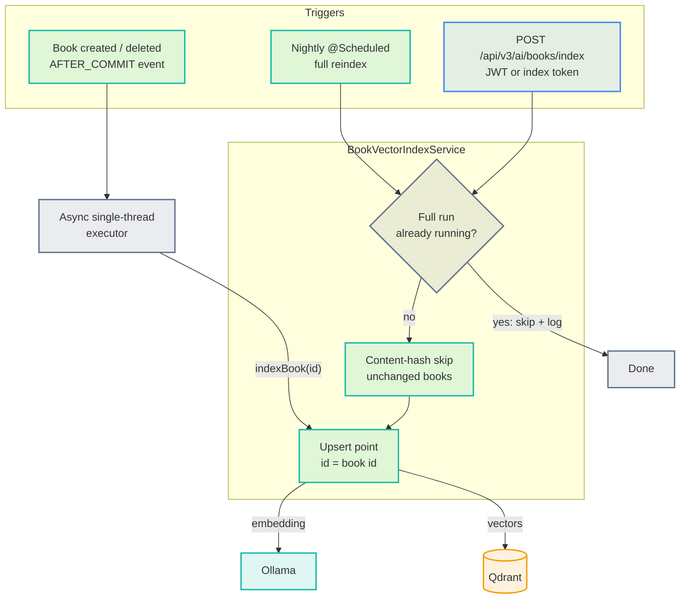
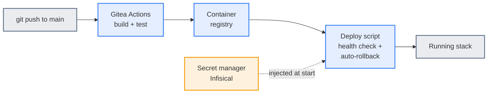
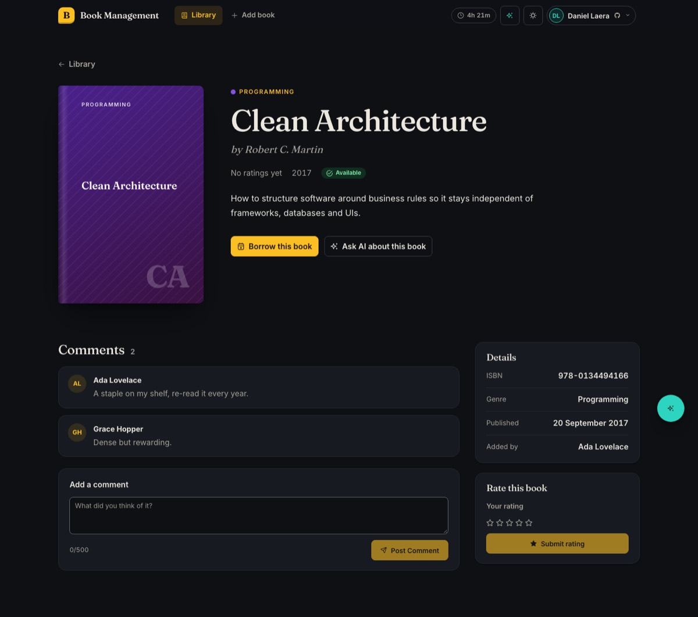
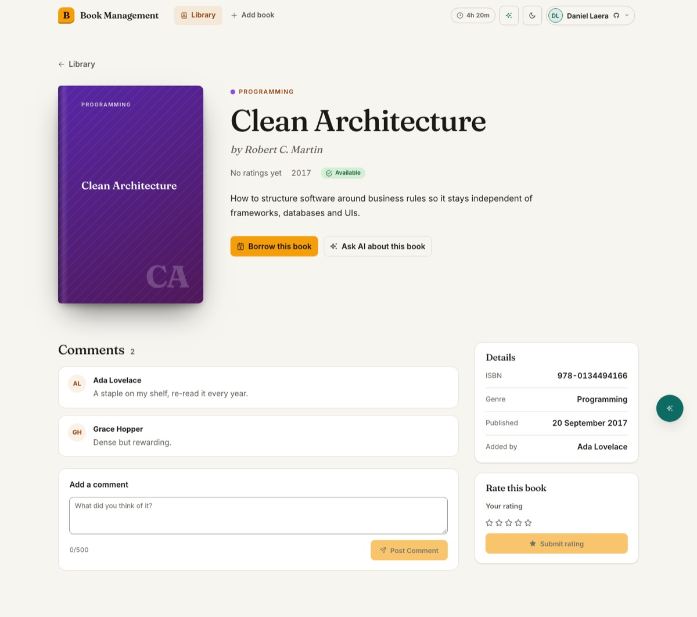

# Book Management: Spring Boot, Angular and an AI library assistant

[](https://github.com/spring-projects/spring-boot)
[](https://openjdk.org/projects/jdk/21/)
[](https://angular.dev/)


A full-stack library app (browse, rate, comment, borrow) with an **AI assistant that answers by calling read-only tools** against the catalogue, and the same tools exposed to external agents through an **MCP server**. Semantic search runs on **Spring AI + Qdrant + local Ollama embeddings**; the chat model is **Claude Haiku 5.5**.

**Live demo:** <https://bookmanagement.daniellaera.com>

| Dark | Light |
|---|---|
|  |  |

*Screenshots show demo data.*

## Key features

- **Catalogue**: CRUD with pagination, sorting and search; ratings, comments and borrowing.
- **Auth**: JWT with refresh tokens, GitHub OAuth2 login.
- **AI chat assistant**: tool-calling agent (max 3 tool calls per question), streamed over SSE.
- **Semantic search**: book embeddings (`nomic-embed-text` via Ollama) in Qdrant.
- **MCP server**: six read-only tools for Claude Code / Claude Desktop, bearer-token protected.
- **Automatic indexing**: nightly run, on-change indexing after create/delete, manual endpoint.
- **Cost protection**: per-user and per-IP daily limits, response cache, feature toggle.
- **Dark and light theme**, Swagger UI in local development.

## Architecture



*Blue is the classic CRUD path, teal the AI path. The chat agent and the MCP server share the same six tools; the backend keeps Qdrant in sync with PostgreSQL itself.*

## AI

### How the assistant answers

The assistant does not receive a dump of the catalogue. It gets a short system prompt and decides which tool to call:

| Tool | Purpose |
|------|---------|
| `search_books` | semantic search by topic or theme (Qdrant) |
| `find_by_title` | exact/partial title lookup |
| `get_book` | full details by id |
| `count_books` | exact totals: all, available, borrowed |
| `list_by_author` | books by author |
| `list_by_genre` | books by genre |

Flow per question: cache lookup, rate limit, Claude Haiku 5.5 with at most 3 tool calls (`ai.max-tool-calls`), answer cached for 24 h. Tools return public catalogue data only, never user data. Details, cost notes and the eval: [docs/AI.md](docs/AI.md).

### MCP server

`POST /mcp` (stateless streamable HTTP, Spring AI MCP server) exposes the same six tools, authenticated with `Authorization: Bearer <MCP_API_TOKEN>` and rate limited (60 requests/minute). The endpoint is closed for everyone when no token is configured. Connection steps for Claude Code and Claude Desktop: [docs/AI.md](docs/AI.md#mcp-server).

### Indexing triggers

| Trigger | When | What |
|---------|------|------|
| `scheduled` | nightly, `app.indexing.scheduled.cron` | incremental full run (content-hash skip) |
| `event` | right after a book is created or deleted | only that book |
| `manual` | `POST /api/v3/ai/books/index` (JWT or `X-Index-Token`) | same run as the nightly one |



*Three triggers share one service. Full runs are guarded and hash-skipped; single-book runs upsert by book id, so repeats never duplicate.*

### AI roadmap (planned, not implemented)

None of the following exists in the code yet:

- Evals in CI (today there is a manual script, `deploy/ai-eval.sh`)
- Tracing of agent tool calls with a self-hosted Langfuse
- Local Apertus 4B versus API models comparison
- Hybrid search plus reranking
- Prompt-injection hardening

## Tech stack

| Layer | Technologies |
|-------|--------------|
| Backend | Spring Boot 4.0.2, Java 21, Spring Security (JWT, GitHub OAuth2), Spring Data JPA, Flyway, WebFlux (SSE), Quartz, SpringDoc OpenAPI |
| AI | Spring AI 2.0.0-M2 (Anthropic, MCP server), Claude Haiku 5.5, Qdrant, Ollama (`nomic-embed-text`) |
| Frontend | Angular 22, TypeScript, PrimeNG 22, signals, SSE streaming |
| Data | PostgreSQL |
| Platform | Docker, nginx, Gitea Actions, Gitea container registry, Infisical |

## Quick start

Prerequisites: Java 21, Node.js 24+, Docker with Compose, [Ollama](https://ollama.com), an Anthropic API key.

```bash
# 1. PostgreSQL + Qdrant
cd backend && docker compose -f docker-compose.db.yml up -d

# 2. Embedding model
ollama pull nomic-embed-text

# 3. Backend (dev profile, http://localhost:8080)
export SPRING_AI_ANTHROPIC_API_KEY=<your-anthropic-key>
./mvnw spring-boot:run -Dspring-boot.run.profiles=dev

# 4. Frontend (new terminal, http://localhost:4200)
cd frontend && npm install && npm start
```

- `npm start` and `npm test` work without a PrimeUI licence key (a banner is shown); `npm run build` needs one. See [docs/DEPLOYMENT.md](docs/DEPLOYMENT.md#primeui-licence-frontend-build).
- Swagger UI (dev only): `http://localhost:8080/swagger-ui.html`. Sign in via `POST /api/v3/auth/signin`, then use **Authorize** with the returned token.
- Tests: `cd backend && ./mvnw test` (Testcontainers, needs Docker) and `cd frontend && npm run test -- --watch=false`.

<details>
<summary>Backend environment variables (production profile)</summary>

| Variable | Description |
|----------|-------------|
| `DATABASE_URL`, `DATABASE_USERNAME`, `DATABASE_PASSWORD` | PostgreSQL connection |
| `JWT_SECRET` | JWT signing secret |
| `FRONTEND_URL` | Frontend URL for CORS |
| `GITHUB_CLIENT_ID`, `GITHUB_SECRET`, `GITHUB_REDIRECT_URI` | GitHub OAuth app |
| `ANTHROPIC_API_KEY` | Anthropic API key |
| `ANTHROPIC_MODEL` | Optional, default `claude-haiku-5-5` |
| `QDRANT_URL`, `OLLAMA_URL` | Vector DB and embedding service |
| `MCP_API_TOKEN` | Optional. Bearer token for `/mcp`; the endpoint answers 401 when empty |
| `INDEX_API_TOKEN` | Optional. `X-Index-Token` for the manual index call |
| `APP_INDEXING_SCHEDULED_ENABLED`, `APP_INDEXING_SCHEDULED_CRON`, `APP_INDEXING_SCHEDULED_ZONE` | Optional nightly run settings (defaults in `application.yml`) |
| `APP_INDEXING_ON_CHANGE_ENABLED` | Optional, default `true` |

</details>

<details>
<summary>API overview</summary>

| Method | Endpoint | Auth |
|--------|----------|------|
| POST | `/api/v3/auth/signup`, `/signin`, `/refreshToken` | Public |
| GET | `/api/v3/auth/me` | USER |
| GET | `/api/v3/book`, `/api/v3/book/{id}` | Public |
| POST / DELETE | `/api/v3/book`, `/api/v3/book/{id}` | USER |
| GET | `/api/v3/ai/books/ask/stream` | Public (per-IP limit) |
| POST | `/api/v3/ai/books/ask` | USER |
| POST | `/api/v3/ai/books/search` | Public |
| POST | `/api/v3/ai/books/index` | USER or `X-Index-Token` |
| GET | `/api/v3/ai/books/remaining` | USER |
| POST | `/mcp` | Bearer `MCP_API_TOKEN` |

Comments, ratings and borrowing endpoints: see Swagger UI.

</details>

## CI/CD and deployment

A push to `main` runs the changed modules' tests, builds and pushes Docker images, and deploys with a health check and automatic rollback; secrets are injected at start and never stored in CI.



Runbook, secrets, rollback and the PrimeUI licence: [docs/DEPLOYMENT.md](docs/DEPLOYMENT.md).

## Design system

Dark-first UI with a warm-neutral surface scale, one amber accent, a teal accent reserved for AI features, Fraunces (display) and Inter (UI), self-hosted via `@fontsource-variable`.

| Dark | Light |
|---|---|
|  |  |

- Tokens live in one file: `frontend/src/theme/app-preset.ts` (a PrimeNG `definePreset(Aura, ...)`).
- Global styles: `frontend/src/styles.scss`; generated cover hues: `frontend/src/app/services/book-visuals.ts`.
- `ThemeService` persists the theme in localStorage and toggles the `my-app-dark` class on `<html>`.

## Database migrations

Flyway manages the schema in `backend/src/main/resources/db/migration/` (`V1` to `V13`). Never edit an applied migration; add a new one.

## License

No license file is included in this repository, so all rights are reserved by default. The project is shared for educational and portfolio purposes; contact the author for other uses.
