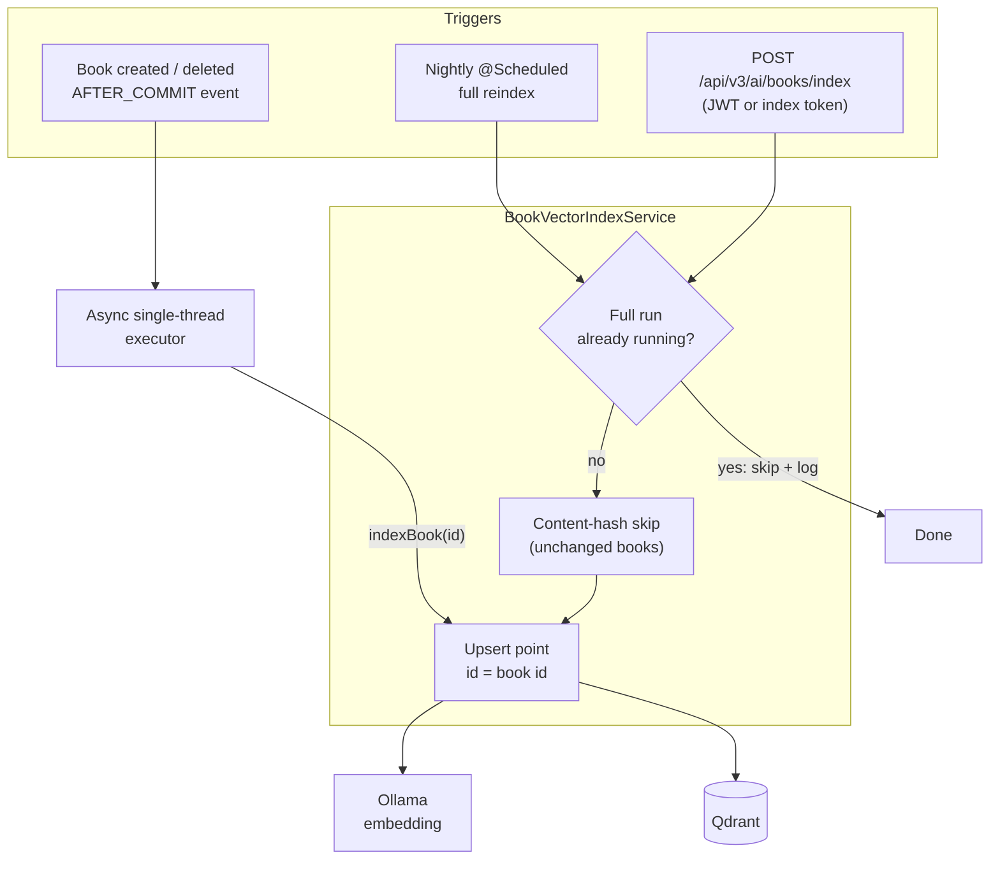
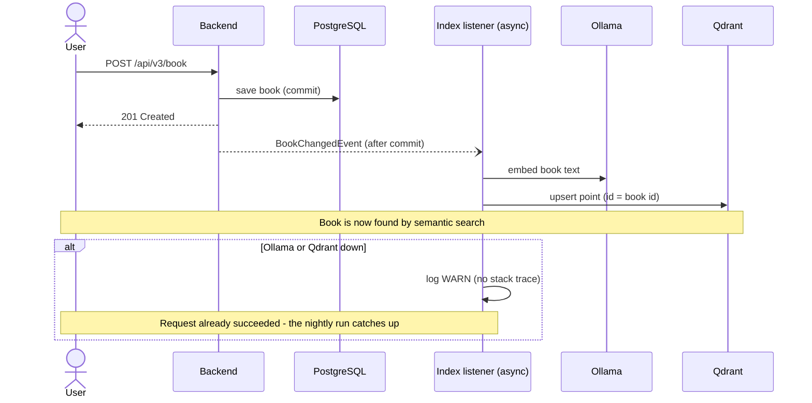

# AI assistant: architecture, tools, MCP

The library assistant (`POST /api/v3/ai/books/ask`, `GET /api/v3/ai/books/ask/stream`) is a Claude Haiku 5.5 chat
(`spring.ai.anthropic`, no temperature/top-p/top-k) that answers by **calling read-only tools** instead of receiving
a dump of books in the prompt. The same six tools are exposed to external agents through an **MCP server**.

```
                         +--------------------------------------+
 browser  -> /api/ask ---> BookAiController                      |
                         |  cache -> rate limit -> ChatClient    |
                         |        system prompt (no book data)   |
                         |        tools: BookTools (3 calls max) |---> BookToolsService ---> BookService / BookRepository (PostgreSQL)
 Claude Code / Desktop   |                                       |                      \--> QdrantSearchService (semantic search, Ollama embeddings)
   -> /mcp (Bearer) ---> McpTokenFilter -> MCP server (stateless  |
                         |   streamable HTTP) -> BookTools (same) |
                         +--------------------------------------+
```

## Tools (defined once in `ai/BookTools.java`, logic in `ai/BookToolsService.java`)
All read-only, public catalogue data only (no comments, borrowers or any user data), no raw SQL (services/repositories).
Output is compact text: `id|title|author|rating|available(Y/N)`.

| Tool | Arguments | Returns |
|------|-----------|---------|
| `search_books` | `query`, `limit` (1-15, default 8), `availableOnly` | **semantic** matches by topic/theme (Qdrant relevance order), fuzzy: it can miss a book named exactly, hence `find_by_title`; empty query + `availableOnly=true` lists borrowable books |
| `find_by_title` | `title`, `limit` | books whose title contains the text (case-insensitive, exact match first) with the exact total; `0` = not in the library. Use for any named book |
| `get_book` | `id` | id, title, author, genre, ISBN, published, rating, availability, description (300 chars max) |
| `count_books` | none | `total=N;available=A;borrowed=B` (exact) |
| `list_by_author` | `author`, `limit` | exact total + up to `limit` rows (case-insensitive partial match) |
| `list_by_genre` | `genre`, `limit` | exact total + up to `limit` rows |

## Chat flow
1. `AiCacheService` (24 h, normalised question) -> hit = 0 tokens.
2. Rate limit: authenticated users `ai.daily-limit` per day, anonymous clients `ai.anonymous-daily-limit` per IP (stream endpoint only).
3. `ChatClient` with the short system prompt and a **fresh `BookTools` per question**, which allows at most
   `ai.max-tool-calls` (3) calls; further calls get "Tool call limit reached". `max-tokens` is 1024.
4. The answer is cached and the call is logged: `AI usage user=... model=... in=... out=... cached=N`.
   `/ask` also returns `inputTokens`, `outputTokens`, `toolCalls`.
The anonymous stream uses the same tools; they only return public catalogue data, so nothing user-specific can leak.

## MCP server
- Starter `spring-ai-starter-mcp-server-webmvc` 2.0.0-M2, protocol **STATELESS streamable HTTP**, endpoint `POST /mcp`
  (JSON-RPC: `tools/list`, `tools/call`). Same six tools, nothing that writes.
- **Auth**: `Authorization: Bearer <MCP_API_TOKEN>`. Separate from user JWTs and from `INDEX_API_TOKEN` (neither opens `/mcp`, and the
  MCP token opens nothing else). No/wrong token = 401; when `MCP_API_TOKEN` is unset the endpoint is closed for everyone.
  The token is compared by SHA-256 digest in constant time (`config/McpTokenFilter.java`).
- **Rate limit**: `mcp.rate-limit-per-minute` (60) requests per minute across the token, then 429 with `Retry-After`.
- **Logs**: one INFO line per tool call `tool=count_books channel=mcp ms=12 chars=31`; arguments and the token are never logged.
- nginx (frontend container) proxies `/mcp` unbuffered to the backend, so it is reachable on the public hostname.

### Set up
```
openssl rand -hex 32          # generate the token; put it in Infisical (project book-management, env prod) as MCP_API_TOKEN
```
`compose.prod.yml` already passes `MCP_API_TOKEN`; redeploy to pick it up (`redeploy.sh <tag>`). Rotate = change in Infisical + redeploy.

### Connect Claude Code
```
claude mcp add --transport http book-library https://bookmanagement.daniellaera.com/mcp \
  --header "Authorization: Bearer $MCP_API_TOKEN"
```
Then `/mcp` in Claude Code lists `book-library` with its six tools; ask e.g. "how many books are available?".

### Connect Claude Desktop
Custom connectors in Desktop use OAuth, so use the `mcp-remote` bridge in `claude_desktop_config.json`
(the token goes through an env var so the space in the header value does not break argument parsing):
```json
{
  "mcpServers": {
    "book-library": {
      "command": "npx",
      "args": ["-y", "mcp-remote", "https://bookmanagement.daniellaera.com/mcp", "--header", "Authorization:${AUTH_HEADER}"],
      "env": { "AUTH_HEADER": "Bearer <MCP_API_TOKEN>" }
    }
  }
}
```

### Quick manual check
```
curl -s -o /dev/null -w '%{http_code}\n' -X POST https://bookmanagement.daniellaera.com/mcp            # 401
curl -s -X POST https://bookmanagement.daniellaera.com/mcp -H "Authorization: Bearer $MCP_API_TOKEN" \
  -H 'Content-Type: application/json' -H 'Accept: application/json, text/event-stream' \
  -d '{"jsonrpc":"2.0","id":1,"method":"tools/list"}'
```

## Semantic search and embeddings (read this before touching the index)
- Embeddings: Ollama `nomic-embed-text` (768 dims, cosine), one Qdrant point per book (`BookVectorIndexService`).
- **The model is case-sensitive.** Documents used to be embedded in Title Case and queries in whatever case the user typed, so a
  Title Case query such as "Effective Java" matched other Title Case texts ("The Great Gatsby") and ranked the real book 27th of 32,
  while "effective java" ranked it first. Measured on the 32 books with each title as the query: top-1 hit 7/32 (before), 20/32
  (lowercased query only), **32/32 (documents and queries both lowercased)**. `nomic-embed-text`'s `search_query:` / `search_document:`
  task prefixes did not help (6/32).
- So both sides are lowercased: `BookVectorIndexService.buildBookText` lowercases the embedded text and `EmbeddingService.embedQuery`
  embeds the normalised (lowercased, whitespace-collapsed) query, the same string that keys the query cache.
- **After deploying this change run the reindex once** (`POST /api/v3/ai/books/index`, header `X-Index-Token`; the nightly scheduled run does it too):
  the content hash changes, so all books are re-embedded (32 Ollama calls). Until then queries are lowercased against old documents
  (20/32), which is already better than before.
- Not a bug: "Qdrant returned 3 results" for a `limit` of 8 means the model passed `limit=3`; Qdrant returns 8 for 8.
  No score threshold (`qdrant.score-threshold: 0`), no filters, the collection holds all 32 points.
- Exact lookups should not depend on embeddings: that is what `find_by_title`, `list_by_author` and `list_by_genre` are for.

## Indexing: how Qdrant stays in sync
Three triggers, one code path (`BookVectorIndexService`; point id = book id, writes are upserts, so repeating any of them never duplicates):
- **scheduled**: `ScheduledBookIndexer`, nightly (replaces the n8n "book-index" workflow). Incremental full run: only new/changed books
  (SHA-256 `contentHash`) are re-embedded, points of deleted books are removed.
- **event**: `BookService` publishes `BookChangedEvent` on create/delete; `BookIndexEventListener` (`@TransactionalEventListener(AFTER_COMMIT)`
  + `@Async` on the single-thread `bookIndexingExecutor`) upserts or deletes just that book. It never slows or fails the HTTP request: errors are one WARN line,
  the nightly run catches up. No coalescing: the handler always indexes the latest DB state, so repeated events only cost redundant embedding calls.
  There is no book update endpoint yet; when one is added, publish `BookChangedEvent.Type.UPDATED` from it.
- **manual**: `POST /api/v3/ai/books/index` (JWT, or `X-Index-Token` = `INDEX_API_TOKEN`), unchanged response shape.
  If a full run is already in progress the response is `{"result":"Skipped: indexing already in progress", all counters 0}`.



*Indexing flow: three triggers share one service; the n8n workflow it replaces is removed. Full runs are guarded and hash-skipped, single-book runs upsert by book id, so repeats never duplicate.*



*Book created to searchable: indexing happens after the response, and a failure is only logged; the nightly full run repairs it.*

Properties (env var in brackets), defaults in `application.yml`:

| Property | Default | |
|---|---|---|
| `app.indexing.scheduled.enabled` [`APP_INDEXING_SCHEDULED_ENABLED`] | `true` | nightly run on/off |
| `app.indexing.scheduled.cron` [`APP_INDEXING_SCHEDULED_CRON`] | `0 0 0 * * *` | Spring cron, 6 fields |
| `app.indexing.scheduled.zone` [`APP_INDEXING_SCHEDULED_ZONE`] | empty = JVM default zone | e.g. `Europe/Zurich` |
| `app.indexing.on-change.enabled` [`APP_INDEXING_ON_CHANGE_ENABLED`] | `true` | on-change indexing on/off (off: deleted books' points are removed by the nightly run) |

Check it in the logs (never contains the token):
```
grep "indexing start" / "indexing done" / "indexing skipped" / "indexing failed"
indexing start trigger=scheduled
indexing done trigger=scheduled books=32 durationMs=1234 indexed=0 skipped=32 deleted=0 failed=0
indexing done trigger=event books=1 durationMs=210 bookId=33
indexing skipped trigger=manual reason=already-running
indexing failed trigger=event bookId=33 type=CREATED error=... (nightly run will catch up)
```
**The n8n "book-index" workflow is obsolete.** Run both in parallel for a few days (safe: idempotent), then disable the n8n
workflow after one successful `indexing done trigger=scheduled` line in prod.

## Cost notes
- Each uncached question costs one model call plus one more per tool round trip (at most 3). Tool results are short rows, so a typical
  question is a small system prompt + one or two tool results; the old approach sent 15 book rows every time.
- Cached questions cost nothing; `/ask` returns `inputTokens`/`outputTokens`/`toolCalls` and the log has one `AI usage` line per call.
- Caps: 3 tool calls, 1024 output tokens, daily limits per user and per anonymous IP, MCP 60 requests/minute (MCP calls cost no model tokens:
  the calling agent pays for its own model).
- Measure for real with `deploy/ai-eval.sh <url> --fresh` (bypasses the cache and prints tokens per question).

## Tests and eval
- `AiToolsITTest` (each tool, real PostgreSQL), `AiChatToolsITTest` (chat flow with a scripted model that calls the real tool callbacks: exact count,
  call budget, anonymous stream), `McpEndpointITTest` (401 without the token, `tools/list`, `tools/call`), `McpTokenFilterTest`, `BookToolsTest`.
  The integration tests do not call Anthropic; whether the real model picks the right tool is what the eval measures.
- Eval: `backend/src/test/resources/ai-eval/questions.json` (17 questions, expectations resolved against the live catalogue; three of them are title lookups) and
  `deploy/ai-eval.sh [base-url] [--fresh]` (no interaction; signs up a throwaway user unless `AI_EVAL_TOKEN` or `AI_EVAL_EMAIL`/`AI_EVAL_PASSWORD` is set;
  one `/ask` per question against that user's daily limit). Exit code 1 below `AI_EVAL_MIN_PASS` (default: all).
- Run the tests on JDK 21 (the local JDK 25 breaks Lombok):
  `docker run --rm -v "$PWD/backend":/app -v ~/.m2:/root/.m2 -v /var/run/docker.sock:/var/run/docker.sock -e TESTCONTAINERS_HOST_OVERRIDE=host.docker.internal -w /app maven:3.9.9-eclipse-temurin-21-alpine mvn -B verify`
  (on Linux hosts drop the override and add `--network host`).
